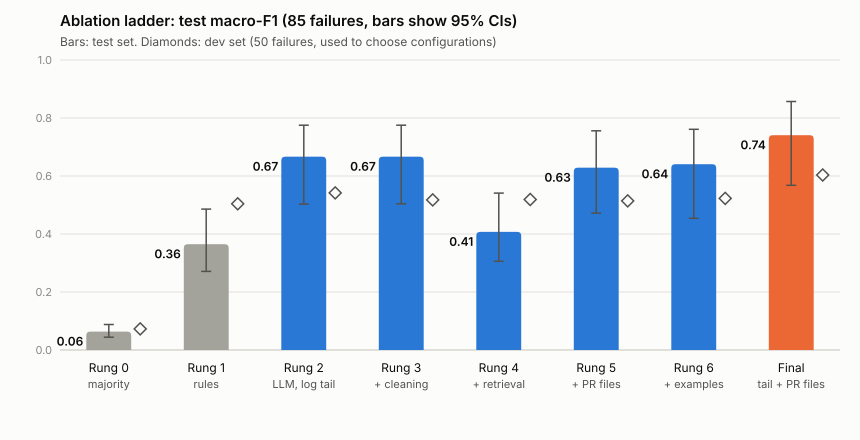

# ci-failure-explainer

When a pull request's CI fails, this GitHub Action comments on the PR with the likely cause and the files to
look at first. It sends the last 200 lines of each distinct failed job plus the PR's changed-file list to
`gemini-3.8-flash`.

What makes it more than a prompt: the configuration was chosen by a **pre-registered evaluation** on 146 real
CI failures from 8 open-source repositories, with frozen labels, a held-out test set of 5 repositories and an
ablation ladder. The full write-up is in [docs/report.en.md](docs/report.en.md).

**Live example:** [lizheng-jp/ci-failure-explainer-demo#1](https://github.com/lizheng-jp/ci-failure-explainer-demo/pull/1),
a pull request with a deliberate pricing bug; the action's comment names the cause and the file.

## Results on the held-out test set (85 failures, 5 repositories)

| | Rules baseline | This action |
|---|---|---|
| Cause category, macro-F1 | 0.36 | **0.74** (+0.38, 95% CI 0.18 to 0.52) |
| Accuracy | 0.54 | **0.75** |
| High-confidence answers: precision / coverage | 0.66 / 68% | **0.85 / 87%** |
| First suggested file is one the fix changed | 0.23 | **0.69** |

What the ablation found: the LLM itself is the big step (+0.30 over rules); the PR's file list adds +0.22,
mostly by recognising flaky failures unrelated to the change; **vector retrieval over the log hurt (-0.26)**;
log cleaning and few-shot examples did nothing. The final configuration was changed after the dev-set results;
the report shows the original-rule system too and lists every caveat.



## Cost

About **US$0.017 per failed run** at today's standard price (median US$0.013): US$7 a month for 20 failed runs
a day, US$73 for 200. Cleaning the log first cuts that by about 60%. The whole evaluation cost US$9.14.

## Use it

1. Add a `GEMINI_API_KEY` repository secret.
2. Copy [examples/explain-ci-failure.yml](examples/explain-ci-failure.yml) into `.github/workflows/` and set
   the name of the workflow to watch.

It runs on `workflow_run`, so it also covers pull requests from forks, and it never checks out or runs the
pull request's code: it only reads the failed run's logs and file list. The logs are treated as untrusted data;
the model's answer is posted as plain text. Low-confidence answers are posted as "needs a human look".

Try it locally without posting anything:

```bash
GITHUB_TOKEN=$(gh auth token) GEMINI_API_KEY=... python action/explain.py --repo owner/name --run-id 123 --dry-run
```

`tests/test_parity.py` checks that the action builds exactly the prompt that was evaluated, for all 135 scored
samples.

## Repository layout

| Path | What |
|---|---|
| `action.yml`, `action/explain.py` | the action |
| `docs/plan.md` | the pre-registered plan and every deviation |
| `docs/report.en.md` | the evaluation report |
| `annotation/` | labelling rules, both annotators' labels, adjudication, frozen labels |
| `scripts/` | sampling, inputs per ladder rung, batch runner, scoring, figures |
| `runs/` | every model answer, per-round selection records, costs |

Raw CI logs are kept out of git (they are third-party data and large); `scripts/collect.py` and
`scripts/joblogs.py` re-download them while GitHub still keeps them (90 days).
