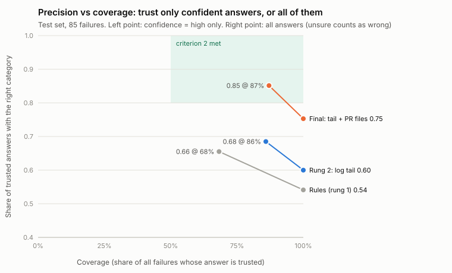
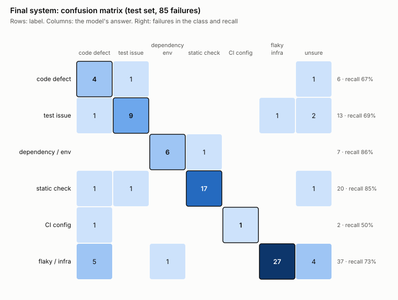

# Diagnosing CI failures with an LLM: evaluation report

> 2026-10-18. The pre-registered plan is [plan.md](plan.md) (section 12 logs every deviation). Data, labels,
> code and every raw model answer are in this repository; the commands at the end reproduce each number.

## Summary

**On 5 open-source repositories that took no part in tuning, `gemini-3.8-flash` reading the last 200 lines of
each failed job plus the list of files the pull request changes diagnosed the cause of CI failures with a
macro-F1 of 0.74, 0.38 above a rules baseline (95% CI 0.18 to 0.52). Its high-confidence answers were right
85% of the time and covered 87% of failures; its first suggested file was a file the fix changed 69% of the
time.** All three pre-registered success criteria are met.

The final system was changed after seeing development-set results. The final system the original written
rules select (log tail only) meets criteria 1 and 3 but not 2: its high-confidence precision is 0.68 against
a 0.80 target.

**Cost:** the whole experiment cost US$9.14 in model calls. Running the final system on every failed CI run
would cost about **US$0.017 per failure** (median US$0.013) at today's standard price, so about **US$73 a
month for 200 failed runs a day**. Section 7 gives the details and the levers.

## 1. The question

When CI fails, can an LLM read the log and name the cause's category, point at the file to change, and say
"unsure" when it cannot tell? Is it clearly better than a few rules?

- **Input**: the failed jobs' logs; from rung 5 on, also the PR's changed-file list.
- **Not visible**: the later fix, the PR title, and whether the failure passed on rerun.
- **Output**: a category (6 classes or `unsure`), confidence (high / low), evidence lines from the log, up to
  3 files, and a one or two sentence explanation.

## 2. Data and labels

| | Dev | Test |
|---|---|---|
| Repositories | pandas, tokio, spring-boot | prometheus, pydantic, vite, uv, kafka |
| Languages | Python, Rust, Java | Go, Python, TypeScript, Rust, Java |
| Samples | 53 (50 scored) | 93 (85 scored) |
| Use | write rules, choose configs | run once, at the end |

- **Samples**: at most one per PR branch from the last 90 days. Each is either a failure followed by a pass on
  a new commit, or a commit that failed and then passed on rerun.
- **Labels**: Claude labelled first and Codex labelled blind. They agreed on 131 of 146 categories (Cohen's
  kappa 0.872). The 18 disagreements were settled by majority vote with a third blind annotator, the model
  under test (gemini-3.8-flash). Labels were frozen and committed before any system under test ran.
- **Not scored**: samples labelled `undeterminable` (the cause cannot be told even from the log and the fix).
- **Sensitivity analysis**: the model under test helped label 15 test samples, 11 of them scored. Every test
  metric is also reported on the 74 scored samples left after removing them.

## 3. Results against the pre-registered criteria

| Criterion | Final system (deviation) | Final system under the original rules (rung 2) |
|---|---|---|
| 1. macro-F1 at least 0.10 above rules, paired 95% CI lower bound > 0 | **met** +0.376 [0.177, 0.522] | **met** +0.302 [0.121, 0.442] |
| 2. high-confidence precision ≥ 0.80 on ≥ 50% of samples | **met** 0.85 on 87% | **not met** 0.68 on 86% |
| 3. file hit@1 ≥ 0.50 | **met** 0.69 | **met** 0.69 |

On the 74-sample sensitivity set the conclusions hold: the final system meets all three (+0.319 [0.12, 0.48]
over rules), and rung 2 meets 1 and 3 but not 2 (0.70).

**As the plan requires, the original-rule conclusion comes first:** the LLM is clearly better than rules and
finds the right file, but on the log alone its high-confidence answers are not reliable enough. With the PR's
changed-file list added, all three criteria are met.

## 4. Ablation ladder


| Rung | Change | Test macro-F1 | Paired difference from the rung before | Dev |
|---|---|---|---|---|
| 0 | majority class | 0.06 | | 0.07 |
| 1 | rules | 0.36 | | 0.50 |
| 2 | LLM reads the last 200 lines of each failed job | 0.67 | **+0.30** [0.12, 0.44] | 0.54 |
| 3 | + log cleaning | 0.67 | 0.00 [-0.03, 0.03] | 0.52 |
| 4 | + in-log retrieval (bge-base, replacing the tail) | 0.41 | **-0.26** [-0.39, -0.08] | 0.52 |
| 5 | + PR changed-file list | 0.63 | **+0.22** [0.06, 0.36] | 0.51 |
| 6 | + 3 worked examples | 0.64 | +0.01 [-0.08, 0.09] | 0.52 |
| final | last 200 lines + PR file list | **0.74** | +0.38 over rules | 0.60 |

Each rung adds one change to the one before, in an order fixed in advance.

- **The LLM itself is the biggest step** (+0.30). The rules fell from 0.50 on dev to 0.36 on test: they
  encode features of the dev repositories (Gradle `checkFormat` task names, Rust `in crate libc`) that do not
  carry over. The LLM scored higher on the unseen repositories than on dev.
- **Retrieval hurts** (-0.26, CI excludes 0). Dense retrieval often ranked toolchain-setup output above the
  real error, and file hit@1 fell from 0.69 to 0.23. Picking log context by semantic similarity does not suit
  failure diagnosis; the failure is usually near the end.
- **The PR file list is the second most useful change** (+0.22). Recall on flaky / infrastructure failures rose
  from 0.38 to 0.73: when the failing test has nothing to do with the files the PR changed, the model is more
  willing to say the change did not cause it.
- **Log cleaning and examples have no visible effect** (both within ±0.03).

## 5. How reliable are confident answers?



The model only reports high or low confidence, so each system has two points: trusting only its high-confidence
answers, or trusting all of them (`unsure` counted as wrong).

- **Final system**: trusting 87% of answers gives precision 0.85, inside the criterion-2 region; trusting all
  gives 0.75.
- **Rules**: lowest at every coverage.
- **In practice**: the final system's high-confidence answers can go straight onto the PR; low-confidence and
  `unsure` answers should be marked "needs a human".

## 6. Where it goes wrong



| Class | Test samples | Recall | Precision |
|---|---|---|---|
| code defect | 6 | 0.67 | 0.33 |
| test issue | 13 | 0.69 | 0.82 |
| dependency / environment | 7 | 0.86 | 0.86 |
| static check | 20 | 0.85 | 0.94 |
| CI configuration | 2 | 0.50 | 1.00 |
| flaky / infrastructure | 37 | 0.73 | 0.96 |

- **Main error**: flaky failures read as code defects (5) or answered `unsure` (4). Most of them passed on a
  plain rerun of the same commit, and their logs look exactly like a real test failure, so a log-only
  diagnosis cannot tell them apart. That is a ceiling of the task, not of the model.
- **Low precision on code defects** (0.33) comes from those flaky failures being put there.
- **By repository**: uv 0.91, prometheus 0.86, vite 0.82, pydantic 0.65, **kafka 0.35**. On 5 of kafka's 10
  scored samples the model answered `unsure` (8 `unsure` answers in the whole test set). Its own explanations
  give the reason: after kafka's failing step come report parsing, cleanup steps and a summary job, so the last
  200 lines of the job hold only those, and the real compile or test error is further up. Answering `unsure`
  there rather than guessing is the intended behaviour.

## 7. Cost

### What the experiment cost

| Item | US$ |
|---|---|
| Rounds 1 to 3 of dev tuning (1,800 batch requests) | 6.64 |
| Test run (510 batch requests) | 2.13 |
| Smoke tests (4 rounds, 3 synchronous calls each) | 0.13 |
| A Gemini Pro batch for the label vote that completed despite a cancel (estimated) | 0.25 |
| **Recorded total** | **9.14** |

Two small items were not logged per call: 18 synchronous gemini-3.8-flash calls for the label vote and one Pro
smoke call, together about US$0.2. All tuning and test calls used the Batch API (half price).

### What it would cost to run

Measured on all 135 scored samples with the frozen final system's prompts (Gemini's token-count endpoint), plus
about 250 output tokens per answer (160 to 320 in smoke tests; low thinking produced no thinking tokens):

| Input per failure | Tokens | Per failure, standard price | Per failure, Batch API |
|---|---|---|---|
| mean | 20,931 | **US$0.017** | US$0.008 |
| median | 15,421 | US$0.013 | US$0.006 |
| 90th percentile | 34,037 | US$0.027 | US$0.013 |
| largest | 127,547 | US$0.097 | US$0.048 |

Prices: US$0.75 per million input tokens and US$3.75 per million output tokens standard, half that for Batch.
These are third-party figures; Google's own price page was not checked. The same sources say the rates double
on 2027-01-01.

A CI bot answers on the PR right after a failure, so it would use standard (synchronous) calls. Per month
(22 working days), one call per failed run:

| Failed CI runs per day | Per month | Today's price | If prices double in 2027 |
|---|---|---|---|
| 20 (a small team) | 440 | **US$7** | US$15 |
| 200 (a product group) | 4,400 | **US$73** | US$146 |
| 2,000 (a large organisation) | 44,000 | **US$730** | US$1,460 |

Levers, cheapest first:

1. **Clean the log before sending it** (drop timestamps and colour codes, fold repeated lines). This cuts input
   from 20,931 to 8,030 tokens on average (-62%), so about US$0.007 per failure, US$31 a month at 200 a day.
   Cleaning did not change macro-F1 on test (rung 2 vs 3: 0.000 [-0.03, 0.03]), but cleaning together with the
   PR file list was not evaluated.
2. **Use the Batch API for non-urgent reports** (for example a daily flaky-test digest): half price, results
   within minutes to hours.
3. **Cap very long inputs**: the largest sample alone costs about 8 times the median.

Latency was not part of the evaluation (all evaluation calls went through the Batch API, whose queueing time
says nothing about a live response). Informally, two dry runs of the action on live failures (prometheus run
39104566012, vite run 39105100070), from fetching the logs to the finished comment, took 18 s and 9 s and used
21,093 and 30,146 input tokens (US$0.017 and US$0.023).

## 8. How far to trust this

1. **The final system was changed after the fact.** Under the written rules, the PR file list was judged on
   "retrieval, 200 tokens x 4 chunks", the one pair out of 9 where it did not help, so it was dropped. After
   seeing that, the final system was changed to "last 200 lines + PR file list". The change used only the dev
   set; the test set had not been run. It is still a choice made after seeing results, which is why section 3
   reports both systems with the original-rule conclusion first.
2. **The model under test helped label the data.** For 16 of the 18 disputed samples the final category is
   gemini-3.8-flash's own answer. Removing those samples (74 left) does not change the conclusions, but the bias
   cannot be ruled out entirely.
3. **The person writing rules and prompts had seen the test set.** Claude read all 146 samples while labelling;
   the rules and prompts were written from the dev set only, but test-set impressions cannot be excluded.
4. **Small classes make macro-F1 jumpy.** The test set has 2 CI-configuration samples and 6 code defects; one
   CI-configuration sample right or wrong moves macro-F1 by about 0.11. Accuracy is steadier: 0.75 for the final
   system, 0.54 for rules.
5. **The test set was "easier" than dev.** The final system scored 0.60 on dev and 0.74 on test. Flaky
   failures are 44% of the test set, and the PR file list helps that class most, which may inflate the gain.
6. **Categories are defined by how the failure was fixed.** Whether the code or the test was wrong, and
   whether a failure was flaky, sometimes cannot be told from the log at all. With code defect and test issue
   merged, macro-F1 is 0.79 (rules 0.41).
7. **One model, one prompt style, 8 large open-source repositories.** This does not represent a company's
   internal CI.

## 9. Recommendations for use

- **Send the last 200 lines plus the PR's changed-file list.** Skip vector retrieval and few-shot examples;
  clean the log to cut cost by about 60%.
- **Post only high-confidence answers directly on the PR**; mark the rest "needs a human".
- **The most useful outputs are which file to look at** (hit@1 0.69, @3 0.77) and **"this failure is probably
  not caused by your change"** (flaky precision 0.96).
- **About US$0.007 to 0.017 per failure**, small next to the engineering time a CI failure costs.
- **Most promising next improvement (not evaluated)**: take the tail of the failing step, not of the whole job.
  All 5 of kafka's `unsure` answers came from long cleanup and summary output after the failing step. This
  needs a new dev round to verify; no number in this report includes it.

## Reproduce

```bash
python scripts/score.py runs/test/final.jsonl --split test                 # every metric for one system
python scripts/score.py compare runs/baselines/r1_rules.test.jsonl runs/test/final.jsonl --split test
python scripts/criteria.py                                                  # the tables in sections 3 and 4
python scripts/figures.py                                                   # the three figures
```

Selection records: [round 1](../runs/r1/SELECTION.md), [round 2](../runs/r2/SELECTION.md),
[round 3](../runs/r3/SELECTION.md); the frozen final system: [FINAL.json](../runs/FINAL.json).
